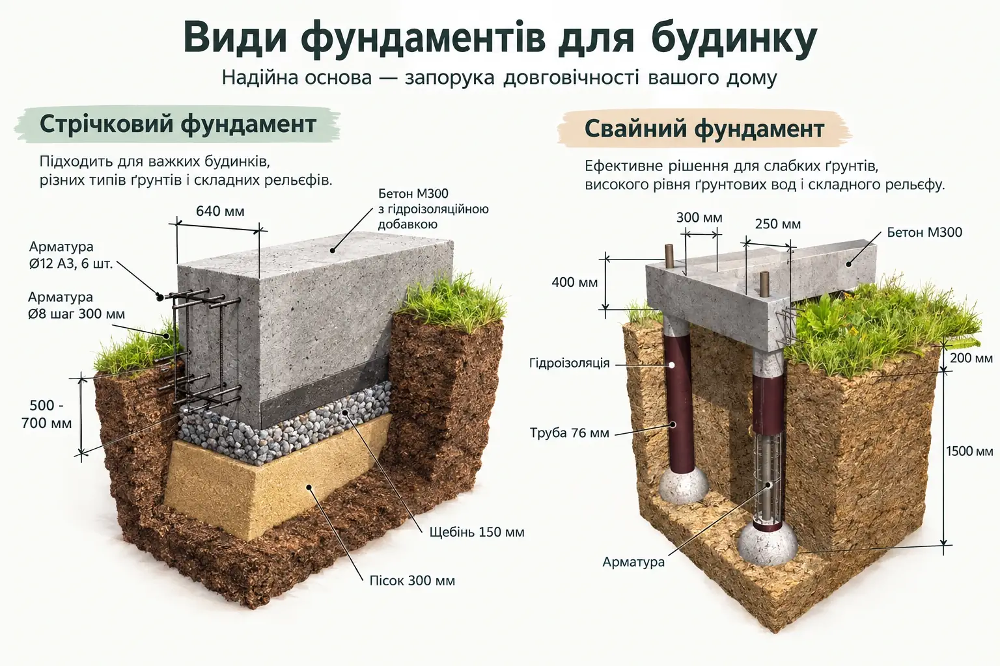
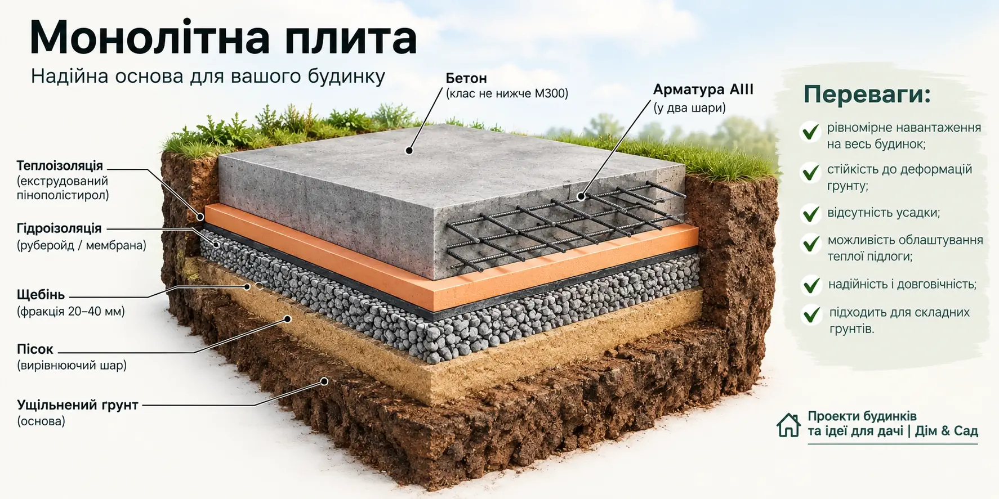
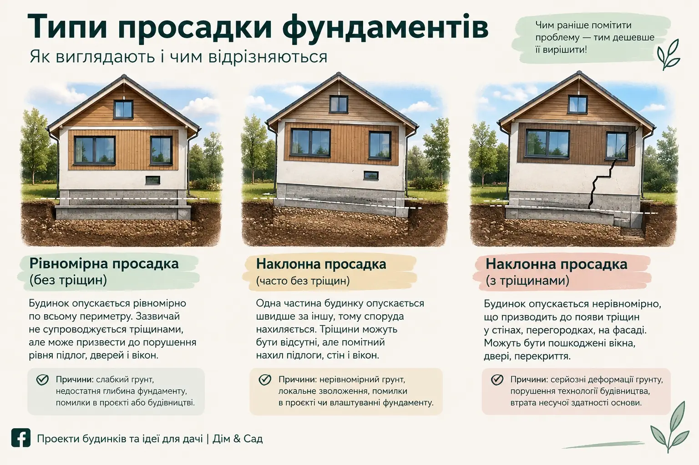

Давайте чесно: фундамент — невдячна частина будівництва. Ви вкладаєте в нього чималу частину бюджету, а в результаті його навіть не видно. Жодних селфі на тлі гарних шпалер чи панорамних вікон. Просто бетон у землі.

Звісно, виникає спокуса заощадити. Але перш ніж вирішити, що «і так зійде», розберемо, як усе працює насправді, і чому «сусід так сто разів робив» — не аргумент.

## Геологія: астрологія для раціоналістів

Багато хто вважає, що геологічні дослідження — змова інженерів, щоб виманити зайві гроші. «Навіщо копати? У сусіда Петровича будинок тридцять років стоїть на шинах, і нічого!»

Проблема в тому, що ґрунт — дама примхлива. Під вашою ділянкою може бути як гранітна скеля, так і лінза пливуна, яка тільки й чекає, щоб перетворити ваш замок на Пізанську вежу. Геологія дає інженеру розуміння, у що саме ви занурюєте палі або на що кладете плиту. Без неї розрахунок фундаменту — ворожіння на кавовій гущі, тільки замість зерен — ваші гроші.

Геологічні дослідження виконує геолог, а не проектувальник. Ми порадимо перевірених виконавців.

## Як інженер «зважує» ваш будинок

Інженер-конструктор — людина, яка у вільний час, імовірно, вираховує опір повітря бутерброда. Коли він береться за ваш фундамент, то враховує все:

* **Вагу стін і перекриттів.** Це зрозуміло.
* **Снігове навантаження.** Коли на дах ляже шар снігу вагою з вантажівку.
* **Корисне навантаження.** Ваша улюблена дубова шафа, рояль і теща, яка приїде на свята.

Усі ці цифри підсумовуються, множаться на коефіцієнти надійності, і інженер видає вердикт. Його завдання — зробити так, щоб тиск будинку на ґрунт був меншим за той, який цей ґрунт може витримати.

Докладніше про те, що входить у проект і навіщо потрібен розрахунок конструкцій, читайте в статті [Скільки коштує проект будинку](/statti/vartist-proektuvannya-budynku/).

## Основні типи фундаментів

Підошву вибирають за ґрунтом і за будинком.

### Стрічковий фундамент

Класика жанру. Буває глибоким (нижче глибини промерзання) та дрібнозаглибленим. Надійний, як швейцарський годинник, якщо правильно армований.

### Пальовий (ростверковий) фундамент

Якщо у вас болото чи схил, палі — ваше все. Головне — занурити їх (забити чи вкрутити) достатньо глибоко, щоб першої ж зими їх не виштовхало. Вартість залежить від кількості й довжини паль.

*Схеми ілюстративні. Розміри, армування й клас бетону визначає розрахунок для конкретного будинку й ділянки.*

### Монолітна плита

«Дорого-багато» і дуже надійно: будинок фактично плаває на бетонному плоті. Часто це добре рішення для слабких і пучинистих ґрунтів, але гаманець після цього зазвичай помітно худне.

## Критерії вибору, або Чому не можна просто скопіювати фундамент сусіда

Вибір фундаменту залежить від трьох «китів»:

1. **Що під землею?** Геологія.
2. **Що зверху?** Вага будинку: цегла чи каркасник — це дві великі різниці.
3. **Ваш бюджет.** Тут усе сумно: чим гірший ґрунт, тим цікавіші фінансові пригоди.

Тож фундамент «як у сусіда» підійде лише тому, у кого такий самий ґрунт і такий самий будинок. Збігається таке рідко.

## Що буває, коли на фундаменті заощадили

Будь-який будинок трохи осідає, і це нормально. Проблеми починаються, коли осідання нерівномірне: будинок нахиляється, а в стінах з'являються тріщини.

І пам'ятайте: виправляти тріснутий фундамент у готовому будинку — це приблизно як лікувати карієс через... ну, ви зрозуміли. Дуже дорого й вкрай неприємно.

## Потрібен фундамент, розрахований під вашу ділянку?

Розкажіть про ділянку й будинок, який ви плануєте. Ми підкажемо, які дослідження потрібні, назвемо вартість проектування й відповімо протягом робочого дня.

**+380 63 251 92 17** · [WhatsApp](https://wa.me/380632519217) · [Telegram @dimproekt](https://t.me/dimproekt) · [dimproekt.am@gmail.com](mailto:dimproekt.am@gmail.com)

*Матеріал має довідковий характер. Тип і розміри фундаменту визначає розрахунок конструктора для конкретного будинку й ділянки.*
