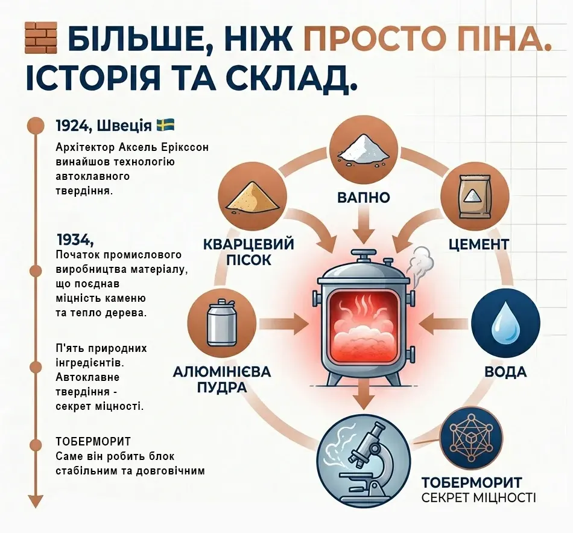
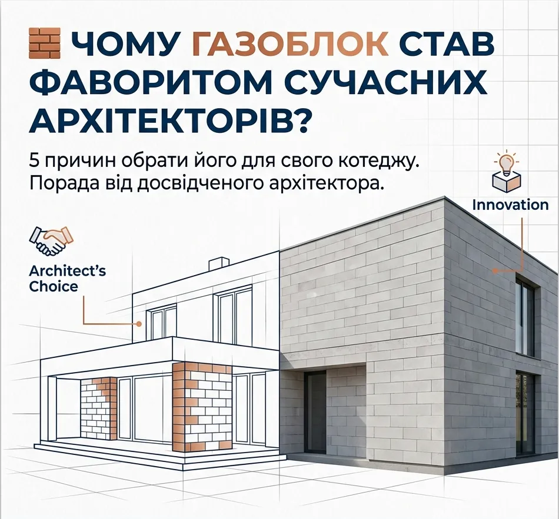
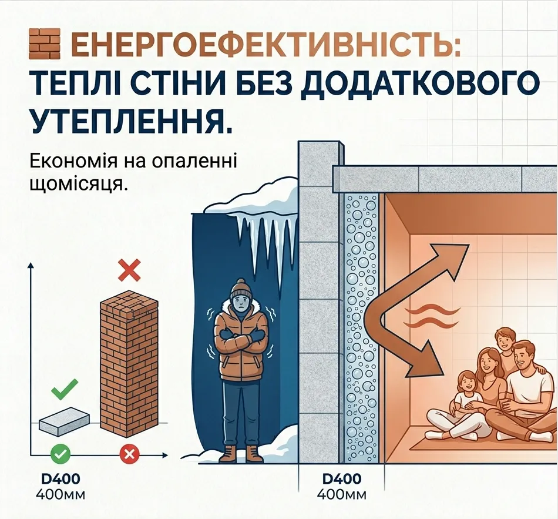
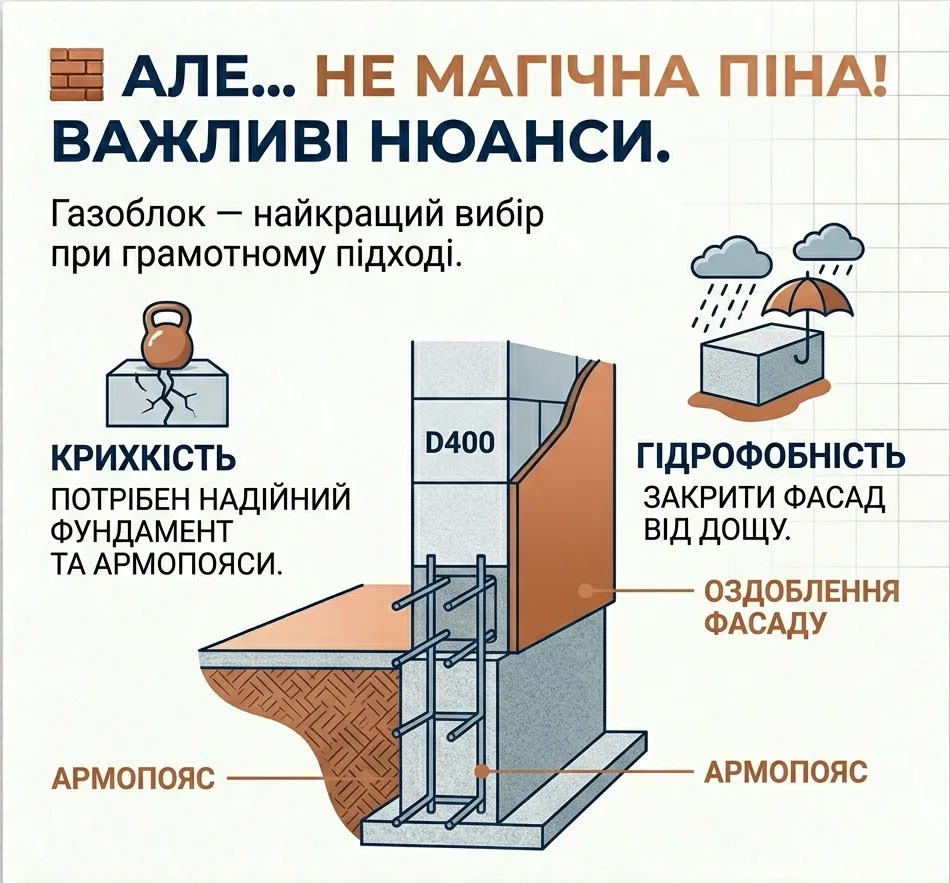

«З чого будувати стіни, щоб було тепло, надійно і не за всі гроші світу?» Це питання нам ставлять майже на кожній першій консультації. За останні двадцять років у приватному будівництві найчастіше звучить одна відповідь: газоблок, або автоклавний газобетон.

Нижче розбираємо, звідки він узявся, чим кращий за цеглу й керамоблок, де в нього слабкі місця і що закласти в проект, щоб вони не стали проблемою.

## Що таке газоблок

Це загальна назва двох близьких матеріалів: газобетону й газосилікату. Вони відрізняються в'яжучим: у газобетоні це цемент, у газосилікаті переважно вапно.

Важливіше інше: блоки бувають автоклавні й неавтоклавні. Автоклавні твердіють у заводських камерах під тиском і температурою близько 180 °C, неавтоклавні — природним шляхом. Неавтоклавні блоки дешевші, але дають більшу усадку, а отже, вищий ризик тріщин. Далі йдеться про автоклавний газобетон — найпоширеніший вибір для житлових будинків.

### Склад і секрет міцності

Склад простий: кварцовий пісок, вапно, цемент, вода й трохи алюмінієвої пудри. Пудра вступає в реакцію з вапном і виділяє водень, який спучує масу, як дріжджі тісто. Так утворюються дрібні закриті пори, до 3 мм. Саме повітря в порах робить блок легким і теплим.

Потім блоки «запікають» в автоклаві. Там утворюється мінерал тоберморит, який і робить газоблок міцним та стабільним.

### Коротка історія

Ідея пористого бетону майже сторічна. Перший патент отримав чех Гоффман ще у 1889 році, але до виробництва справа не дійшла. У 1924 році шведський архітектор Юхан Аксель Ерікссон запатентував технологію автоклавного твердіння: він шукав матеріал із якостями дерева — теплий, легкий в обробці, — але довговічний і негорючий, як камінь.

Перші заводські партії блоків випустили у 1929 році в Швеції під маркою Ytong, а з 1934 року, коли свій спосіб запропонувала фірма Siporex, виробництво набуло промислових масштабів і почало поширюватися світом. Тож це не «новий недосконалий матеріал», а технологія з майже столітньою історією.

## Чому архітектори обирають газоблок

Коли ми проектуємо будинок, то дивимося на три речі: тепло, економіку будівництва і комфорт у будинку. Газоблок сильний у кожній.

### Тепло

Повітря в порах — один із найкращих утеплювачів, тому газоблок утримує тепло значно краще за цеглу. Для зовнішніх стін зазвичай беруть блок щільністю D400–D500 завтовшки 400–500 мм. За такої товщини стіна часто відповідає вимогам до теплоізоляції без додаткового утеплення пінопластом чи мінватою. Це залежить від марки блока, конструкції стіни й оздоблення, тому теплотехнічний розрахунок варто робити для конкретного будинку, а не покладатися на загальні цифри.

### Швидкість і точна геометрія

Один блок за площею в кладці замінює приблизно 15–20 цеглин, тому коробка будинку зводиться значно швидше. Якісні блоки мають відхилення розмірів усього 1–2 мм. Їх кладуть на тонкий шар клею, а не на товстий розчин: шви виходять мінімальними, і «містків холоду» стає менше. Стіну можна вирівняти тонким шаром шпаклівки замість товстої штукатурки.

Блок легко пиляється, свердлиться й штробиться звичайним інструментом, тому інженерні комунікації прокладати зручно.

### Легка конструкція

Газоблок значно легший за цеглу, тому навантаження на фундамент менше, і фундамент може вийти легшим та дешевшим. Але «легший» не означає «без розрахунку»: фундамент у будь-якому разі розраховують за геологією ділянки.

### Мікроклімат і безпека

Газобетон складається лише з мінеральних компонентів: він не горить і не виділяє шкідливих речовин. Він пропускає водяну пару, тому стіни не накопичують зайву вологу, якщо в будинку правильно налаштована вентиляція. Природна радіоактивність газобетону низька: у його складі немає гранітного щебеню.

## Порівняння з цеглою й керамоблоком

Ми порівняли три матеріали за чотирма критеріями для типового садибного будинку. Оцінка від 1 до 5, де 5 — найкраще. Це наша практична оцінка, а не результат лабораторних випробувань.

| Критерій | Газоблок | Керамоблок | Цегла |
|---|---|---|---|
| Теплоізоляція | 5 | 4 | 2 |
| Швидкість монтажу | 5 | 4 | 2 |
| Вартість стіни (5 — найдешевше) | 5 | 4 | 2 |
| Простота робіт | 5 | 3 | 2 |

## Слабкі місця, про які мовчать продавці

Газоблок — не «магічна піна». У нього є слабкі місця, і кожне вирішується проектом та правильною технологією.

**Крихкість на вигин.** Газоблок добре працює на стиск, але погано на згин. Тому під ним потрібні надійний фундамент і армопояси, які розподіляють навантаження. Якщо фундамент осідає нерівномірно, стіна дає тріщини.

**Вбирає воду.** Пори, які дають тепло, вбирають і вологу. Стіни не можна роками залишати без зовнішнього оздоблення: фасад закривають штукатуркою або фасадною системою, а між фундаментом і першим рядом блоків укладають гідроізоляцію.

**Потребує спеціального кріплення.** Звичайні дюбелі в газобетоні не тримають, потрібні спеціальні, для газобетону. Тому навісне обладнання краще планувати заздалегідь.

**Не любить грубого поводження.** Блок крихкий, тому його краще розвантажувати на піддонах і зберігати під накриттям.

## Що закласти в проект

Газоблок працює без проблем, коли всі ці «але» враховані на кресленнях, а не вирішуються на будмайданчику:

1. **Фундамент за геологією ділянки.** Саме він визначає, чи будуть тріщини.
2. **Армопояси.** Їхнє розташування і розрахунок належать до конструктивного розділу (КР).
3. **Вузли.** Примикання перекриттів, віконних прорізів і цоколя.
4. **Теплотехніка й захист фасаду.** Марка й товщина блока, оздоблення зовнішніх стін.

Докладніше про те, з чого складається проект і навіщо потрібен розділ КР, читайте в статті [Скільки коштує проект будинку](/statti/vartist-proektuvannya-budynku/).

### Як вибирати блоки

Перед купівлею перевірте чотири речі: чи блок автоклавний, чи марка щільності (D400, D500) і клас міцності відповідають проекту, чи відхилення розмірів не перевищують 1–2 мм, чи є сертифікат і паспорт на партію.

## Хто виробляє газоблок

Орієнтиром якості в Європі вважають Ytong (Xella, Німеччина), H+H (Данія) і Solbet (Польща).

В Україні працює кілька заводів автоклавного газобетону. Нижче наведено найвідоміші. Це не рейтинг: якість залежить від конкретної партії, тому перевіряйте сертифікат і геометрію блоків, як описано вище.

**AEROC.** Два заводи, в Обухові та Березані Київської області.

**Стоунлайт.** Завод у Броварах Київської області.

**ХСМ.** Завод у Харківській області.

**UDK Gazbeton.** Виробництво в Дніпрі.

Наявність і потужності заводів змінюються, тому перед закупівлею уточніть їх на сайті виробника.

## Слово архітектора

Якщо ваша мета — теплий сучасний будинок за розумні гроші й у стислі терміни, для більшості садибних будинків газоблок сьогодні майже поза конкуренцією. Але виграє той, хто будує за проектом із розрахованим фундаментом, армопоясами й захищеним фасадом, а не просто купує блоки. Газоблок — матеріал, який вимагає грамотного підходу.

## Обговоримо матеріал стін для вашого будинку?

Напишіть або зателефонуйте й розкажіть про ділянку та бажаний будинок. Ми підкажемо, який матеріал стін підійде, назвемо вартість проектування й відповімо протягом робочого дня.

**+380 63 251 92 17** · [WhatsApp](https://wa.me/380632519217) · [Telegram @dimproekt](https://t.me/dimproekt) · [dimproekt.am@gmail.com](mailto:dimproekt.am@gmail.com)

*Матеріал має довідковий характер. Теплотехнічні й конструктивні рішення визначаються проектом конкретного будинку.*
