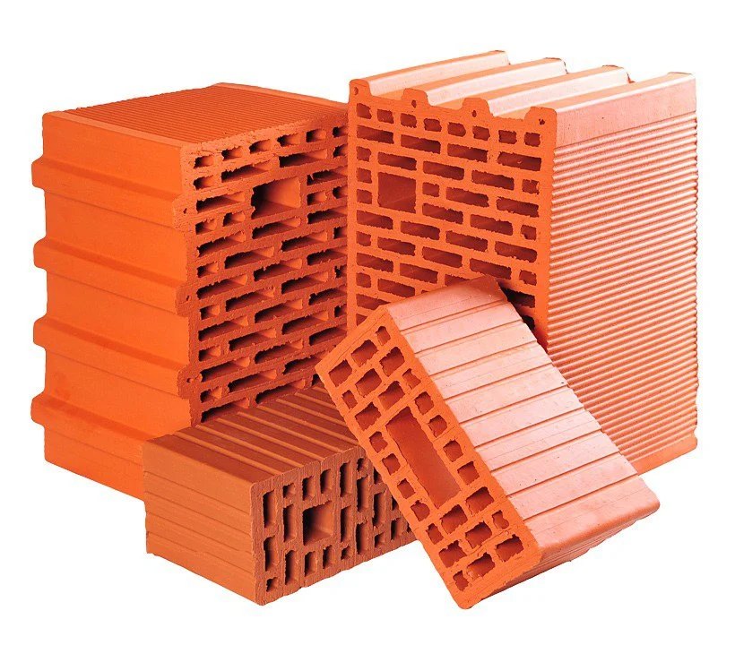
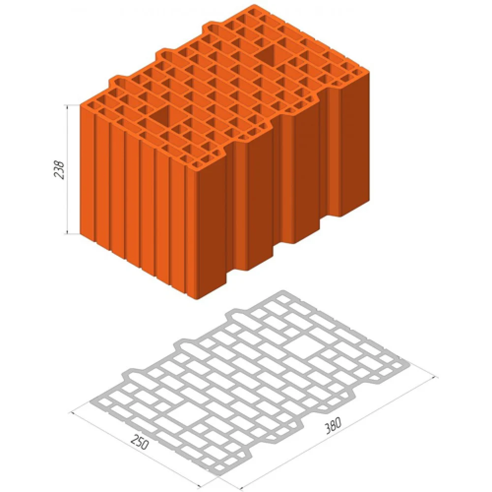
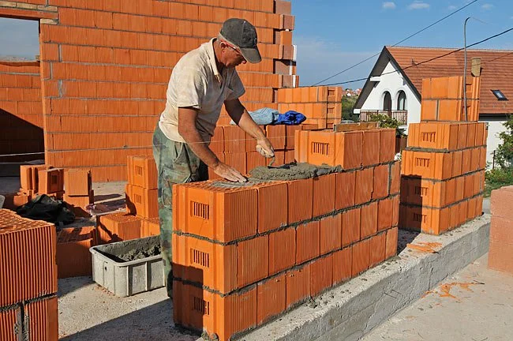
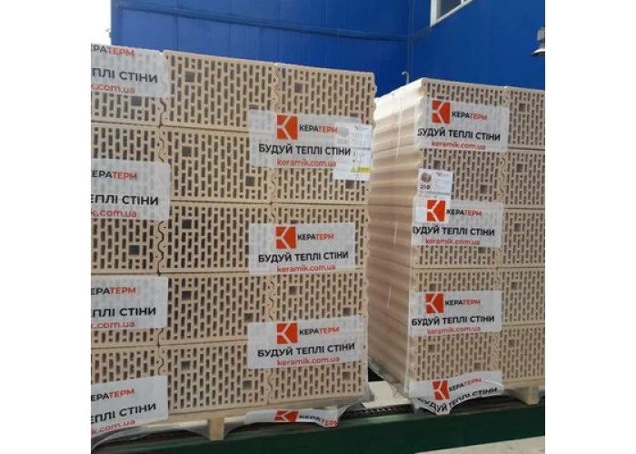
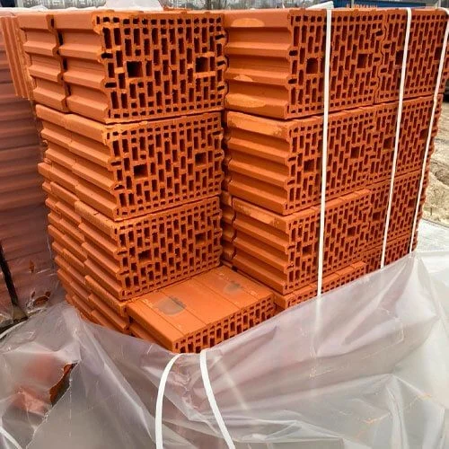

Керамоблок — міцний і довговічний стіновий матеріал, що продовжує тисячолітню традицію випаленої глини. Його роблять із природної сировини — глини, води та тирси, яка вигорає під час випалювання і залишає в черепку дрібні замкнені пори. Завдяки цьому блок поєднує надійність цегли з нижчою вагою й кращим теплозахистом, а будувати з нього можна в кілька разів швидше.

Ось ті об'єктивні властивості, за які керамоблок цінують архітектори й будівельники:

- **Висока міцність.** Марка М100–М130: за даними виробників, з нього можна зводити несучі стіни будівель до 5–6 поверхів із залізобетонними перекриттями. Для садибного будинку це великий запас надійності.

- **Пожежна безпека.** Випалена кераміка не горить (клас А1) і не виділяє шкідливих речовин у разі пожежі.

- **Довговічність.** Морозостійкість F25–F50, біологічна інертність: кераміка не гниє, не цвіте й не приваблює гризунів.

- **Стабільна геометрія.** Випалений блок не дає усадки, тому стіни й штукатурка не тріскають через висихання матеріалу.

- **Здоровий мікроклімат.** Кераміка паропроникна: стіни вирівнюють вологість повітря в приміщеннях і не виділяють синтетичних речовин.

- **Теплова інерція.** Масивна керамічна стіна акумулює тепло: взимку будинок повільно вихолоджується, а влітку довше зберігає прохолоду. Це особливо цінно під час відключень електроенергії та опалення.

- **Звукоізоляція.** Стіна з блока 38 гасить близько 48 дБ повітряного шуму.

- **Швидке й ощадне будівництво.** Один блок 38 замінює близько 11 цеглин. Завдяки замку «паз-гребінь» вертикальні шви не заповнюють розчином, і його витрата зменшується в 2–3 рази порівняно з цегляною кладкою.

Нижче — коротка історія матеріалу, огляд українського ринку й цін, теплотехнічний розрахунок за чинними нормами, порівняння з газоблоком і наші рекомендації: у яких випадках керамоблок розкриває свої переваги повністю.

## Що таке керамоблок

Керамоблок (поризований керамічний камінь, «тепла кераміка») — це великоформатний блок із випаленої глини. До сировини додають тирсу або інші добавки, які вигорають під час випалювання і залишають дрібні пори. Разом із вертикальними пустотами (пустотність 50–57 %) це робить блок легшим і теплішим за звичайну цеглу.

Блоки мають пазогребеневі торці, тому вертикальні шви кладуть без розчину, а горизонтальні — на розчин завтовшки близько 10–12 мм. Цифра в назві означає товщину стіни в сантиметрах:

| Формат | Розмір блока, мм                        | Витрата, шт/м² | Призначення                                          |
|--------|-----------------------------------------|----------------|------------------------------------------------------|
| 12     | 120 × 500 × 238 (залежно від виробника) | —              | перегородки                                          |
| 25     | 250 × 380 × 238                         | 10,5           | внутрішні несучі стіни; зовнішні — лише з утепленням |
| 38     | 380 × 250 × 238                         | 16             | зовнішні несучі стіни                                |
| 44     | 440 × 250 × 238                         | 16             | зовнішні несучі стіни підвищеної теплозахисту        |

Вага блока 38 — близько 17–18 кг, марка за міцністю — типово М100, морозостійкість — F25–F50 залежно від виробника.

## Історична довідка

Керамоблок — результат довгої еволюції цегли, яку людство випалює вже кілька тисячоліть.

1.  **Античність.** Римляни вже застосовували порожнисті керамічні елементи: їх знаходили, зокрема, під час розкопок римських терм у британському Баті.

2.  **Середина XIX століття.** З’явилися стрічкові шнекові преси: машину німецького інженера Карла Шлікейзена описали в 1856 році. Глину стало можливо протискувати крізь форму з вставками, і порожниста цегла після 1850 року стала масовим фабричним продуктом.

3.  **1950-ті роки.** У післявоєнній Німеччині потрібен був легкий і теплий матеріал для відбудови. У 1952 році поризована цегла вперше отримала власні вимоги в німецькому стандарті DIN 105.

4.  **1960–1990-ті.** У Західній Європі сформувалися системи великоформатних поризованих блоків із замком «паз-гребінь» — німецький Poroton і австрійський Porotherm концерну Wienerberger, заснованого ще в 1819 році. Сьогодні Wienerberger — найбільший у світі виробник порожнистої цегли.

5.  **2000-ні.** Коли вимоги до теплозахисту в Європі посилилися, з’явилися блоки з утеплювачем усередині. У 2001 році в Німеччині вийшов Poroton-T9 із порожнинами, заповненими перлітом, що дозволив зводити одношарові стіни без фасадного утеплення.

6.  **Україна.** Великоформатний поризований блок прийшов на наш ринок у 2000–2010-х роках, коли запрацювали сучасні заводи з європейським обладнанням. Зокрема, завод «Закарпатська будівельна кераміка» в Іванівцях відкрили 27 вересня 2011 року, а Кузьминецький завод оснащений лініями англійських, італійських, іспанських і чеських виробників.

## Ринок України: хто виробляє і де купити

Великоформатний керамоблок в Україні виробляють кілька вітчизняних заводів, а європейський Porotherm продається через дилерів. У торгових мережах на кшталт «Епіцентру» в каталозі є блоки ЗБК, Керамейі, Кератерму та СБК, але наявність залежить від регіону. Тому обсяг на цілий будинок надійніше замовляти в офіційного дилера або безпосередньо на заводі.

| Торгова марка                                                                             | Виробник, завод                                                                                                                                                          | Великоформатні блоки        | Де купити                                     |
|-------------------------------------------------------------------------------------------|--------------------------------------------------------------------------------------------------------------------------------------------------------------------------|-----------------------------|-----------------------------------------------|
| [Кератерм](https://keraterm.com.ua/product-category/keramichni-bloki/)                    | Кузьминецький завод ([≈ 80 км від Києва](https://www.inventure.com.ua/en/investments/clay-blocks-manufacturing-brick-plant)) та завод у Бережанах (Тернопільщина)        | 10, 12, 19, 25, 38, 44      | офіційні дилери, будівельні інтернет-магазини |
| [ТеплоКерам](https://kievstroy.org/ua/keramoblok-teplokeram-25-250-380-238-kerameya.html) | «Керамейя», Україна                                                                                                                                                      | 25, 38, а також 2,12 НФ     | «Епіцентр», дилери                            |
| [ЗБК Ecoblock](https://keramobloki.com.ua/keramichnij-blok/)                              | «Закарпатська будівельна кераміка» ([ТОВ «Русинія»](https://web.kpi.kharkov.ua/ceramic/wp-content/uploads/sites/122/2025/07/TOV-Rusyniya-.pdf), с. Іванівці, Закарпаття) | 12, 25, 25 XL, 38, 45       | «Епіцентр», дилери                            |
| [СБК «Керамкомфорт»](https://kievstroy.org/ua/keramichni-bloku/)                          | завод у с. Озера, Київщина                                                                                                                                               | 20, 25, а також 2 НФ        | дилери, під замовлення                        |
| Porotherm (Wienerberger)                                                                  | австрійський концерн, в Україні — через дилерів                                                                                                                          | 25, 30, 38, 44 та доборні ½ | дилери                                        |

Дрібноформатний керамічний блок 2 НФ («подвійна цегла») випускають також FP-KLINKER, Євротон, Kerambud та інші заводи, але для зовнішніх стін садибного будинку зазвичай обирають великий формат.

### Скільки коштує керамоблок

| Формат  | Кератерм, грн/шт | ТеплоКерам, грн/шт | ЗБК Ecoblock, грн/шт | Porotherm, грн/шт | Орієнтовна ринкова ціна, грн/шт | Блоки на 1 м² стіни, грн |
|---------|------------------|--------------------|----------------------|-------------------|---------------------------------|--------------------------|
| 25      | 86–99            | 96                 | 76–128               | ≈ 116–119         | 85–130                          | 900–1350                 |
| 38      | 99–104           | 96                 | ≈ 76                 | ≈ 121             | 95–125                          | 1500–2000                |
| 44 / 45 | 129              | —                  | 90                   | ≈ 155             | 120–155                         | 1900–2500                |

Ціни орієнтовні, за даними інтернет-магазинів і торгових мереж станом на листопад 2026 року, і потребують уточнення перед закупівлею. Заводські ціни та ціни на обсяг для цілого будинку можуть бути помітно нижчими: вони залежать від кількості блоків, що ми купуємо, дальності доставки й умов дилера. Вартість доставки маніпулятором до ділянки закладайте окремо.

Ринок рухається в обидва боки. На Тернопільщині завершують запуск заводу [ТОВ «Поризована кераміка»](https://biz.ligazakon.net/news/239073_na-ternoplshchin-zapustyat-zavod-z-virobnitstva-budvelnikh-materalv) потужністю до 30 млн умовної цегли на рік — рядова цегла і керамоблоки. Водночас завод СБК у с. Озера на Київщині [виставлено на продаж](https://tascombank.ua/files/Prodazh._Kompleks._Kyivska_obl.,_Borodianskyi_r-n.,_s._Ozera,_vul._Partyzanska,_bud._71.pdf), а два заводи FP-KLINKER — [також](https://inventure.com.ua/en/news/ukraine/two-fp-klinker-brick-and-ceramic-block-plants-put-up-for-sale-at-dollar16-million). Для замовника це означає одне: перед проектуванням варто переконатися, що обрана марка реально є в наявності в потрібному обсязі, і порахувати доставку від заводу до ділянки.

## Теплотехніка: чи потрібне утеплення

Утеплення потрібне завжди, навіть для блока 44. ДБН В.2.6-31:2021 для I температурної зони (Київщина та більша частина країни) вимагають від зовнішньої стіни приведеного опору теплопередачі RΣпр не менше за 4,0 м²·К/Вт. Типові рішення з альбомів виробників (К44 без утеплення, К38 + 50 мм, К25 + 100 мм) розраховані на старі норми 2016 року (3,3) і сьогодні дають лише 2,9–3,7.

Друга причина — різниця між «каталожною» і реальною теплопровідністю. Виробник вказує λ самого блока в сухому стані (Кератерм: К44 — 0,13; К38 — 0,14; К25 — 0,18 Вт/(м·К)). У стіні ж працює кладка: блок з експлуатаційною вологістю (умови Б, коефіцієнт 1,13) плюс горизонтальні шви 12 мм. Звичайний цементно-піщаний розчин має λ 0,93 — у 5–7 разів більше, ніж у блока, і кожен шов стає містком холоду.

Ми розрахували, який утеплювач потрібен, щоб стіна пройшла чинні норми (фасадна система ETICS, з урахуванням укосів, перемичок, армопоясу і сталевих дюбелів):

| Стіна                           | Реальна λ кладки, Вт/(м·К) | EPS графітовий, мм | Мінеральна вата, мм | EPS білий фасадний, мм |
|---------------------------------|----------------------------|--------------------|---------------------|------------------------|
| Газоблок D400, 300 мм, на клеї  | 0,130                      | 100                | 150                 | 120                    |
| Керамоблок 44, теплий розчин    | 0,149                      | 80                 | 100                 | 100                    |
| Керамоблок 44, цементний розчин | 0,184                      | 100                | 150                 | 120                    |
| Керамоблок 38, теплий розчин    | 0,160                      | 100                | 150                 | 120                    |
| Керамоблок 38, цементний розчин | 0,195                      | 120                | 150                 | 150                    |
| Керамоблок 25, цементний розчин | 0,238                      | 150                | 200                 | 180                    |

Зверніть увагу: кладка з блока 44 на звичайному розчині потребує стільки ж утеплювача, скільки газоблок 30 см. Пластикові або втоплені дюбелі дають близько 8 % запасу і інколи дозволяють зменшити товщину на один крок.

## Обмеження та недоліки: що варто знати перед вибором

- **Ціна стіни.** За кубометр керамоблок і газоблок коштують майже однаково, але керамічна стіна товща (38–44 см проти 30 см) і все одно потребує утеплення.

- **Вага.** Метр квадратний кладки з блока 38 важить у 2–2,5 разу більше, ніж з газоблоку D400 300 мм. Це навантаження на фундамент, важливе на слабких грунтах.

- **Товсті шви.** Розчин 10–12 мм проти клею 2–3 мм у газоблоку: більше «мокрих» процесів і містків холоду. Теплий розчин допомагає, але за нашими розрахунками не окуповується: дешевше класти на звичайний розчин і додати 20 мм утеплювача.

- **Крихкість і обробка.** Різати блок треба спеціальною пилкою, а бій під час перевезення й підрізання треба закласти в запас матеріалу.

- **Кріплення.** У порожнистий блок звичайний дюбель тримає погано; для котла, шаф і консолей потрібні довгі дюбелі або хімічні анкери. Точкові навантаження від балок і перемичок розподіляють через армопояс або подушки.

- **Нерівна якість партій і доступність.** Декларована λ у різних виробників для блока 38 — від 0,14 до 0,18 Вт/(м·К); варто вимагати протокол випробувань. Мережа заводів невелика, тож доставка в далекий регіон помітно додає до ціни.

## Керамоблок чи газоблок

Газоблок виграє за ціною, вагою і теплом, керамоблок — за міцністю та масивністю. Порівнюємо типові для садибного будинку варіанти зовнішньої стіни:

| Показник                               | Газоблок D400, 300 мм  | Керамоблок 38           | Керамоблок 25           |
|----------------------------------------|------------------------|-------------------------|-------------------------|
| Міцність на стиск                      | ≈ М35 (клас B2,5)      | М100 і вище             | М100 і вище             |
| Реальна λ кладки, Вт/(м·К)             | 0,130                  | 0,160–0,195             | 0,238                   |
| Вага кладки, кг/м² стіни               | ≈ 150                  | ≈ 330                   | ≈ 220                   |
| Шов                                    | клей 2–3 мм            | розчин 10–12 мм         | розчин 10–12 мм         |
| Усадка                                 | є, поки блок висихає   | немає                   | немає                   |
| Обробка                                | ріжеться ручною пилкою | спеціальна пилка, є бій | спеціальна пилка, є бій |
| Утеплення за ДБН 2021 (EPS графітовий) | 100 мм                 | 100–120 мм              | 150 мм                  |
| Загальна товщина стіни з оздобленням   | ≈ 43 см                | ≈ 51–53 см              | ≈ 43 см                 |

Вага кладки — оцінка з урахуванням розчину та експлуатаційної вологості; для розрахунку фундаменту беруть дані конкретного виробника. Зайві 8–10 см товщини стіни з блока 38 — це приблизно 4–5 м² втраченої площі забудови на кожні 50 м периметра.

Ринок газоблоку тим часом зростає: колишні заводи «Аерок» у Березані та Обухові [працюють під брендом Poriston](https://forbes.ua/news/kolishni-gazobetonni-zavodi-aerok-povertayutsya-na-rinok-pid-novim-brendom-04062025-30288), а група «Ковальська» [вводить новий завод у Розвадові](https://inventure.com.ua/en/news/ukraine/kovalska-nears-completion-of-euro100-million-aerated-concrete-plant-in-rozvadiv) на Львівщині. Газоблок доступний майже в будь-якому регіоні, і це теж аргумент.

## Економіка: скільки коштують стіни будинку

На стінах двоповерхового будинку площею близько 150 м² керамоблок 38 додає близько 100 тис. грн до кошторису матеріалів, а блок 44 — близько 190–230 тис. грн. Розрахунок для 200 м² зовнішніх стін без вікон і дверей; усі варіанти мають однаковий теплозахист за ДБН 2021.

| Схема стіни                                                   | 1 м² стіни з EPS графітовим (блок + клей або розчин + утеплювач), грн | 1 м² стіни з EPS білим (блок + клей або розчин + утеплювач), грн | Стіни для 200 м² з EPS графітовим, тис. грн | Різниця з газоблоком |
|---------------------------------------------------------------|-----------------------------------------------------------------------|------------------------------------------------------------------|---------------------------------------------|----------------------|
| Газоблок D400 300 мм (Poriston / кол. «Аерок») + 100 / 120 мм | 1513–1627                                                             | 1397–1511                                                        | 303–325                                     | база                 |
| Газоблок D400 300 мм (Стоунлайт) + 100 / 120 мм               | 1615–1747                                                             | 1499–1631                                                        | 323–349                                     | +7 %                 |
| Керамоблок 25, ЦП-розчин + 150 / 180 мм                       | 1641                                                                  | 1467                                                             | 328                                         | +5 %                 |
| Керамоблок 38, ЦП-розчин + 120 / 150 мм                       | 2108                                                                  | 1981                                                             | 422                                         | +34 %                |
| Керамоблок 38, теплий розчин + 100 / 120 мм                   | 2276                                                                  | 2160                                                             | 455                                         | +45 %                |
| Керамоблок 44, ЦП-розчин + 100 / 120 мм                       | 2510                                                                  | 2394                                                             | 502                                         | +60 %                |
| Керамоблок 44, теплий розчин + 80 / 100 мм                    | 2718                                                                  | 2633                                                             | 544                                         | +73 %                |

У назві схеми перша товщина утеплювача — для EPS графітового, друга — для EPS білого. Білий EPS дешевший, але потребує на 20–30 мм більшої товщини, ніж графітовий (див. таблицю у розділі про теплотехніку). Ціни — Київ, листопад 2026, без робіт, доставки й комплектуючих фасадної системи. Різниця — відносно середини діапазону першого рядка (≈ 314 тис. грн).

Що ці цифри не показують, але варто додати до керамоблоку:

- масивніший фундамент під вдвічі важчі стіни (для блоків 38 і 44);

- більший обсяг кладки в кубометрах — відповідно дорожча робота мулярів;

- доставку з віддаленого заводу: наприклад, керамоблок із Бережан для Києва дорожчий на 210–320 грн за м² стіни.

Єдиний керамічний варіант, що тримається на рівні газоблоку, — блок 25 з товстим утепленням 150–180 мм.

## Коли ми рекомендуємо керамоблок

У нашій практиці типова зовнішня стіна садибного будинку — газоблок D400 300 мм із 100 мм фасадного утеплення. Керамоблок ми радимо тоді, коли вирішальними є міцність чи масивність, а не вартість.

**Керамоблок виправданий, якщо:**

1.  Будинок має два–три поверхи, монолітні перекриття або великі прольоти, і газоблок D400 не проходить за несучою здатністю (альтернатива — газоблок D500 або каркас).

2.  На стіни будуть спиратися важкі елементи: консольні балкони, камін із димарем, лицювальна цегла чи клінкер у тришаровій стіні.

3.  Ділянка біля дороги або залізниці, і важлива звукоізоляція.

4.  Замовник свідомо хоче «кам'яний» дім із великою тепловою інерцією і готовий за це доплатити.

5.  Завод поруч із ділянкою, а бригада має досвід роботи саме з керамікою.

6.  Будинок зводять у сейсмічному районі — на Закарпатті, Буковині чи в інших районах з розрахунковою сейсмічністю 7–8 балів за ДБН В.1.1-12. Для стін із дрібних блоків ніздрюватого бетону норми в таких районах обмежують висоту двома надземними поверхами, а при 9 балах — одним. Міцна керамічна кладка в поєднанні з антисейсмічними залізобетонними поясами та сердечниками — перевірене рішення для таких умов; конкретну конструкцію визначає розрахунок.

**Краще обрати газоблок, якщо:**

- будинок одноповерховий або з мансардою та дерев'яним перекриттям;

- бюджет обмежений, і заощаджені 100–200 тис. грн корисніше вкласти в вікна, вентиляцію чи тепловий насос;

- грунти слабкі, і кожна тонна ваги піднімає вартість фундаменту;

- важлива швидкість будівництва і мінімум «мокрих» процесів.

**Якщо обрали керамоблок:** блок 25 з утепленням 150 мм — найрозумніший компроміс за ціною, якщо це підтверджує розрахунок несучої здатності. Кладіть на звичайний розчин, а заощаджене вкладіть у товщий утеплювач. Вимагайте від продавця протокол випробувань з λ і маркою міцності та не вірте альбомним рішенням «без утеплення»: вони складені за старими нормами.

## Висновок

Керамоблок — надійний, довговічний і екологічний матеріал з найвищою серед легких стінових блоків міцністю. Але ця надійність має свою ціну. За нашими розрахунками для Київщини, стіна з керамоблоку 38–44 см з утепленням коштує на 30–70 % дорожче за стіну з газоблоку D400 тієї самої теплотехнічної якості. А популярна обіцянка «44-й блок не треба утеплювати» за чинними нормами вже не працює.

Тому керамоблок найкраще розкривається там, де важливі його сильні сторони: у дво- чи триповерховому будинку з важкими перекриттями, у сейсмічних районах, біля джерел шуму або тоді, коли замовник свідомо хоче масивний керамічний дім. У типовому одноповерховому садибному будинку газоблок D400 із фасадним утепленням дає той самий теплозахист дешевше, легше й тоншою стіною.

Про сам газоблок, його сильні й слабкі місця читайте в статті [«Газоблок для будинку»](/statti/gazoblok-dlya-budynku/).

Вибір стінового матеріалу варто робити до проектування фундаменту й разом із теплотехнічним розрахунком саме вашого будинку. Архітектурна майстерня «Дімпроект» допоможе порівняти варіанти стін для вашої ділянки, кліматичної зони й бюджету.

## Хочете підібрати стіни для свого будинку?

Розкажіть про ділянку, кількість поверхів і бюджет. Ми порахуємо варіанти стін і скажемо, де керамоблок виправданий, а де вистачить газоблока.

**+380 63 251 92 17** · [WhatsApp](https://wa.me/380632519217) · [Telegram @dimproekt](https://t.me/dimproekt) · [dimproekt.am@gmail.com](mailto:dimproekt.am@gmail.com)
