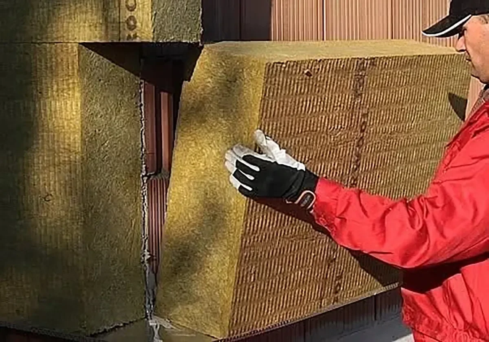
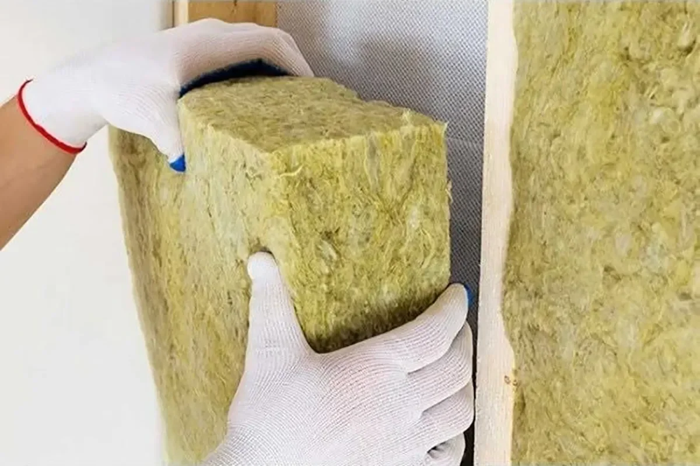
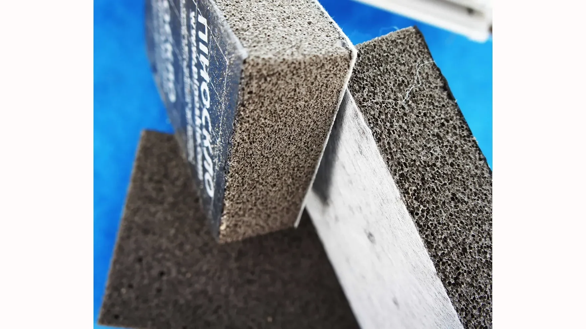
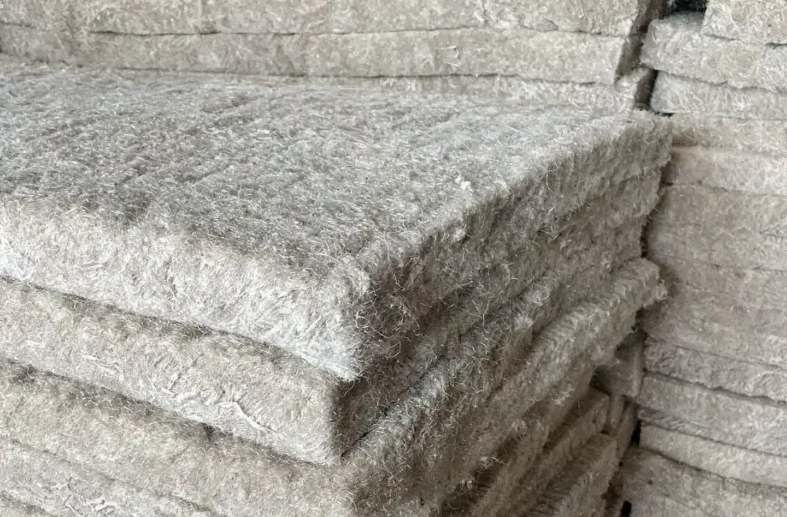
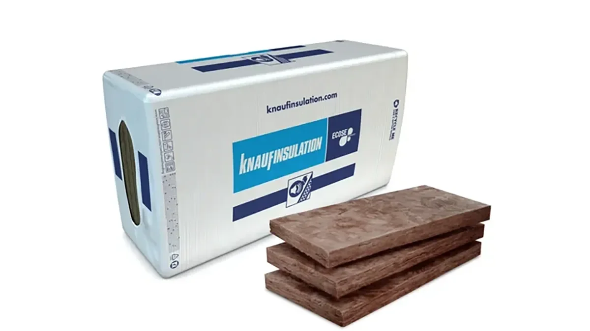
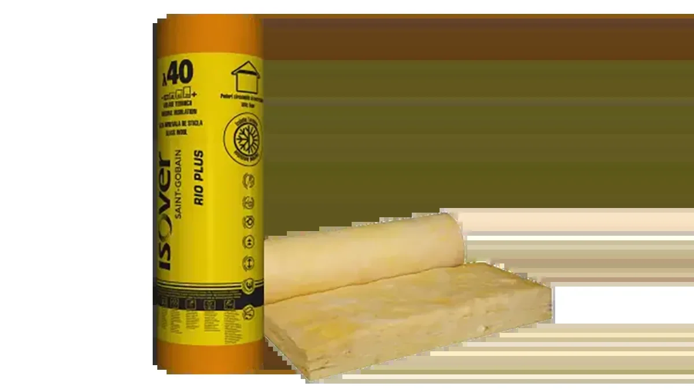
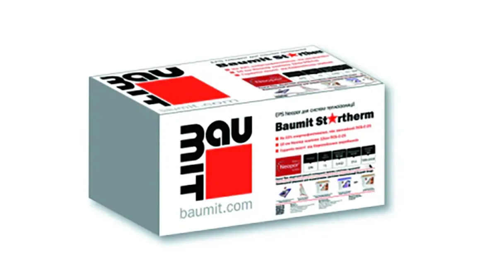
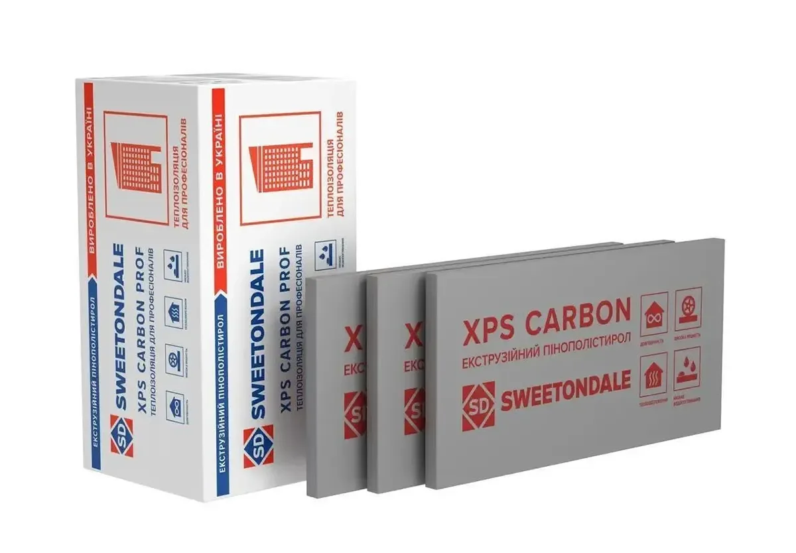

Щосезону починається одне й те саме. Хтось просить: «Порадьте найкращий утеплювач!» І пішло-поїхало:

> «Мінвата — топ!»
>
> «Пінопласт дешевший і не гірший!»
>
> «XPS тільки й урятує!»
>
> «Та ви взагалі не розумієтеся!»

Давайте чесно: «найкращого» утеплювача не існує. Є той, що підходить вашому будинку, і той, що створить проблеми через 2–3 роки. Розберемося без фанатизму.

## Усе вирішує «пиріг» стіни

Утеплювач не можна вибирати окремо від стіни. Головне правило: паропроникність шарів має зростати зсередини назовні, тобто водяна пара має вільно виходити з будинку, а не застрягати всередині стіни.

* **Цегла чи бетон.** Підходять майже всі системи утеплення.
* **Газоблок.** Тут обережніше. Він «дихає», тобто пропускає водяну пару, тому для нього частіше вибирають мінеральну вату (наприклад, Rockwool, Knauf Insulation, Isover), яка теж паропроникна. Якщо газоблок «закрити» пінопластом (EPS) чи XPS без теплотехнічного розрахунку, зокрема точки роси, волога може залишитися всередині стіни. А далі: сирість, грибок, тріщини. Економія виходить дуже дорогою.

Докладніше про газоблок читайте в статті [Газоблок для будинку](/statti/gazoblok-dlya-budynku/).

## Де саме утеплюємо

### Фундамент і цоколь

Тут мінвата програє: волога її знищить. Працює XPS (екструдований пінополістирол, наприклад Sweetondale): він не боїться води й витримує тиск ґрунту.

### Фасад приватного будинку

Найчастіше обирають пінопласт (EPS) через ціну: його використовують у багатьох системах фасадної теплоізоляції, зокрема Baumit. Але пам'ятайте: він горючий і потребує правильного захисту штукатуркою. Мінеральна вата дорожча, зате негорюча.

### Складні форми, еркери, заокруглення

Жорсткий пінопласт не ляже щільно. Мінвата гнучкіша: вона краще повторює форму, і містків холоду буде менше.

## Технологія важливіша за бренд

Можна купити дорогий утеплювач і зіпсувати все монтажем.

* **«Мокрий фасад» (ETICS).** Утеплювач під тонкошарову штукатурку: класика для приватних будинків.
* **Вентильований фасад.** Як правило, тільки негорюча мінвата й вентиляційний зазор.

Криві руки здатні «вбити» будь-яку систему швидше, ніж мороз.

## А що з новинками

Є аерогель (технології NASA): легкий, тонкий, негорючий. Але ціна поки що «космічна».

Є напилюваний ППУ (пінополіуретан): створює безшовний «кокон», але потребує професійного обладнання.

Інновації є, але масовий ринок усе ще живе мінватою та пінопластом.

## Мінеральні альтернативи: не тільки вата

Окрім мінеральної вати, існують й інші мінеральні утеплювачі.

### Перліт

Легкий спучений вулканічний матеріал. Його використовують як засипку в перекриттях і підлогах.

**Плюси:** негорючий, екологічний.
**Мінус:** потребує правильного захисту від вологи.

### Піноскло

Дуже міцний і повністю вологостійкий матеріал. Підходить для цоколя, плоских дахів і місць із високим навантаженням.

**Плюси:** не горить, не вбирає воду, не гниє.
**Мінус:** дорожчий за більшість утеплювачів.

### Пінобетон

Його використовують як теплоізоляційно-конструкційний шар. Це вже не «утеплювач-плита», а елемент конструкції.

**Плюси:** паропроникний, негорючий.
**Мінус:** для гарного ефекту потрібна значна товщина.

## Органічні утеплювачі: тренд на екологічність

Дедалі частіше забудовники дивляться в бік натуральних рішень. Їх особливо люблять у каркасному будівництві та енергоефективних будинках.

### Ековата

Целюлозний утеплювач з антипіренами.

**Плюси:** хороша шумоізоляція, заповнює порожнечі.
**Мінус:** потребує професійного нанесення.

### Конопляні мати

**Плюси:** натуральний матеріал, добре регулює вологість.
**Мінус:** ціна вища за мінвату.

### Деревне волокно

Популярне в каркасних будинках.

**Плюси:** «дихає», хороша тепло- та звукоізоляція.
**Мінус:** боїться постійної вологи.

## Підсумок: три запитання

Перестаньте шукати «найкращий» утеплювач. Краще дайте відповідь на три запитання:

1. **З чого побудовано будинок?**
2. **Який бюджет?**
3. **Хто буде монтувати?**

Іноді правильний монтаж важливіший за вибір матеріалу. А ще утеплення краще закласти в проект: теплотехнічний розрахунок для вашого будинку покаже, який матеріал і яка товщина справді потрібні.

## Де шукати утеплювачі

Усі ці матеріали продаються в Україні, у будівельних магазинах і в інтернеті. Нижче наведено виробників, на сайтах яких можна знайти характеристики й дізнатися, де купити. Назви наведено як приклади продукції, що є в продажу: це не рейтинг і не реклама.

**Rockwool.** Кам'яна (базальтова) вата: плити для фасадів, покрівель і перегородок. [Сайт Rockwool Україна](https://www.rockwool.com/ua/)

**Knauf Insulation.** Скловата в рулонах і плитах для утеплення покрівель, стін і перекриттів. [Сайт Knauf Україна](https://knauf.com/uk-UA)

**Isover.** Скловата в рулонах. Isover RIO Plus призначена для горищ, скатних покрівель, перекриттів і перегородок. [Сторінка Isover RIO Plus](https://www.isover.ua/%D0%9F%D1%80%D0%BE%D0%B4%D1%83%D0%BA%D1%86%D1%96%D1%8F/isover-rio-plus)

**Baumit Startherm.** Пінопластові плити (EPS) для систем фасадної теплоізоляції. [Сторінка Baumit Startherm](https://baumit.ua/produkti/sistemi-zovnishnoyi-teploizolyaciyi/sistema-teploizolyaciyi-power-visokomicna/baumit-startherm?category=skladovi-komponenti-dlya-ulashtuvannya-teploizolyaciyi)

**Sweetondale.** Екструдований пінополістирол (XPS) українського виробництва для цоколя й фундаменту.

## Не знаєте, який утеплювач підійде вашому будинку?

Розкажіть, з чого ви будуєте або плануєте будувати. Ми підкажемо, як узгодити матеріал стін і утеплення, назвемо вартість проектування й відповімо протягом робочого дня.

**+380 63 251 92 17** · [WhatsApp](https://wa.me/380632519217) · [Telegram @dimproekt](https://t.me/dimproekt) · [dimproekt.am@gmail.com](mailto:dimproekt.am@gmail.com)

*Матеріал має довідковий характер. Конструкцію стіни й товщину утеплення визначає теплотехнічний розрахунок для конкретного будинку.*
